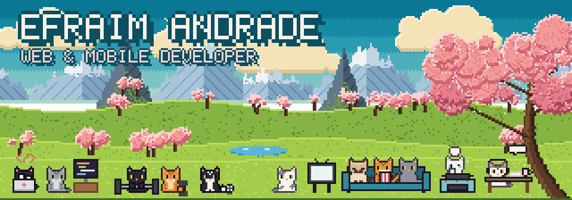

### Hi there, I'm Efraim Andrade 👋

I'm a web & mobile developer. I've spent the last 8 years building apps of every kind.

#### What I work with

     

#### Find me

My site is [efraimandrade.work](https://www.efraimandrade.work).

  
